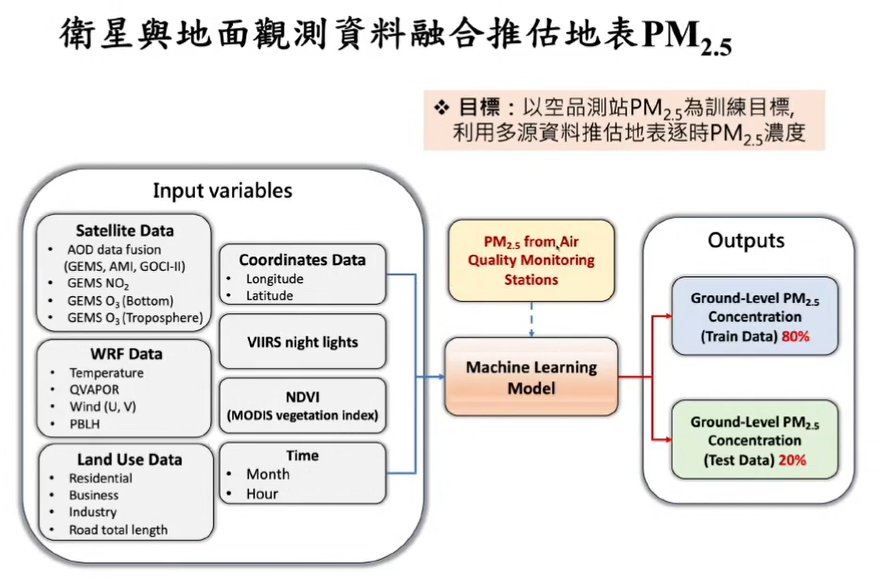
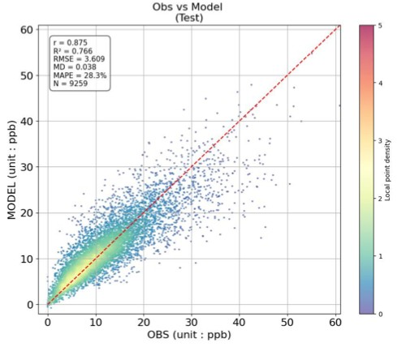
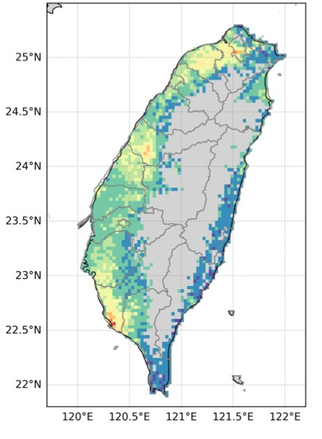

# 2023 春季地面 $\text{NO}_2$ 濃度推估與多源資料分析專案

本專案整合靜止軌道衛星觀測（GEMS）、WRF 數值氣象模擬、地表土地利用及夜間燈光等多源資料，利用 **XGBoost 機器學習模型** 推估 2023 年春季（3 月至 5 月）台灣地區地面 $\text{NO}_2$ 濃度的時空分佈。

---

## 📂 一、數據資料結構與變數說明 (Data Structure & Variables)

數據資料統一儲存於 `data_2023` 資料夾，目錄結構與各數據項目的詳細說明如下：

```text
data_2023/
├── AOD
├── GEMS_NO2
├── Land
├── Merged/
│   └── 2023
├── NDVI
├── O3
├── VIIRS/
│   └── VIIRS_NC/
│       ├── coarse
│       └── native
├── WRF
└── WRF_SWD
```

### 數據項目與任務說明

| 資料夾名稱 | 中文資料名稱 | 任務說明與繪圖重點 |
| :--- | :--- | :--- |
| **`AOD`** | 氣膠光學厚度 | 繪製空間分佈圖；作為推估大氣懸浮微粒與光化學反應之關鍵衛星特徵。 |
| **`GEMS_NO2`** | 靜止軌道環境監測光譜儀 $\text{NO}_2$ | 繪製空間分佈圖；提供對流層 $\text{NO}_2$ 柱濃度，為模型預測地面 $\text{NO}_2$ 之核心指標。 |
| **`Land`** | 土地利用資料 | 包含住宅、商業、工業區分佈及道路總長度，反映人為排放源之空間強度。 |
| **`Merged/2023`** | 2023年整合數據集 | 將衛星、氣象、土地利用及測站觀測依時空網格對齊合併後的訓練與預測資料集。 |
| **`NDVI`** | 常態化植被指數 | 繪製空間分佈圖；評估植被覆蓋率對地表擴散與大氣吸收之影響。 |
| **`O3`** | 臭氧資料 | 繪製空間分佈圖；作為氣體光化學反應（$\text{NO}_x-\text{O}_3$ 循環）之輔助特徵。 |
| **`VIIRS`** | 衛星夜間燈光資料 | 包含 NetCDF 格式之原生 (`native`) 與粗解析度 (`coarse`) 資料，反映都市化與夜間活動強度。 |
| **`WRF`** | 天氣研究與預報模式 | 繪製氣象參數分佈圖（含溫度、水氣混合比 $\text{QVAPOR}$、$\text{U/V}$ 風場、混合層高度 $\text{PBLH}$）。 |
| **`WRF_SWD`** | WRF 短波輻射資料 | 繪製地表接收太陽輻射強度分佈圖，影響大氣光化學反應速率。 |

---

## 🤖 二、XGBoost 模型訓練與架構 (Modeling Framework)



參考多源資料融合架構（如衛星 + 氣象 + 土地利用 + 測站觀測），設定如下：

### 1. 建模條件與資料切分
* **時間範圍**：2023 年春季（3 月至 5 月）。
* **地形過濾**：**高度 $> 500\text{m}$ 的網格需從預測與評估結果中先予以移除**（排除高海拔山區）。
* **訓練目標 ($y$)**：環保署/空品監測站之地面逐時 $\text{NO}_2$ 觀測濃度 ($\text{ppb}$)。
* **資料集劃分**：**Training Set (80%)** 與 **Testing Set (20%)**。

### 2. 特徵變數 (Input Features)
* **Satellite Data**: AOD, GEMS $\text{NO}_2$, GEMS $\text{O}_3$
* **WRF Data**: Temperature, QVAPOR, Wind ($\text{U}, \text{V}$), PBLH
* **Land Use Data**: Residential, Business, Industry, Road total length
* **Other Features**: Coordinates ($\text{Lon}, \text{Lat}$), VIIRS night lights, NDVI, Time ($\text{Month}, \text{Hour}$)

### 3. 模型輸出要求
1. **Model Performance**: 輸出 Training Set 與 Testing Set 的統計評估指標。
2. **SHAP Value**: 計算並繪製 SHAP Summary Plot，說明各變數對模型決策的特徵貢獻度。
3. **Spring Average Surface $\text{NO}_2$**: 產出 2023 春季全台地面平均濃度推估網格。

---

## 📈 三、模型效能評估散布圖規範 (Performance Evaluation Plot)



模型效能評估需繪製 **Ground Truth vs Prediction** 散布圖，格式規範如下：

* **座標軸**：
  * **X 軸**：$\text{GND (unit : ppb)}$（測站實際觀測值）
  * **Y 軸**：$\text{PRED (unit : ppb)}$（模型推估值）
* **圖表元素**：
  * **1:1 參考線**：紅色虛線（對角線）。
  * **Colorbar**：依據局部點密度（Local point density）套用20色離散彩虹色階。
  * **統計評估指標框（左上角浮動框）**：
    * $r$ (相關係數)
    * $R^2$ (決定係數)
    * $\text{RMSE}$ (均方根誤差)
    * $\text{MD}$ (平均偏差, Mean Deviation)
    * $\text{MAPE}$ (平均絕對百分比誤差, %)
    * $N$ (總樣本數)

---

## 🗺️ 四、春季平均地面 $\text{NO}_2$ 濃度空間分佈圖規範 (Spatial Map)



推估之 2023 春季平均地面 $\text{NO}_2$ 濃度空間地圖規範如下：

* **地圖區域**：台灣本島與周邊海域（經度約 $120^\circ\text{E} - 122^\circ\text{E}$，緯度約 $21.8^\circ\text{N} - 25.5^\circ\text{N}$）。
* **座標與圖例**：包含經緯度網格線 (Gridlines) 及濃度色階尺 (Colorbar, $\text{unit: ppb}$)。