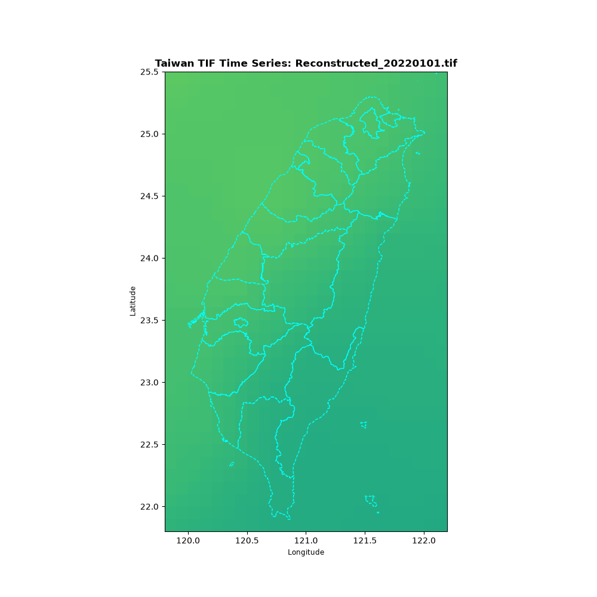
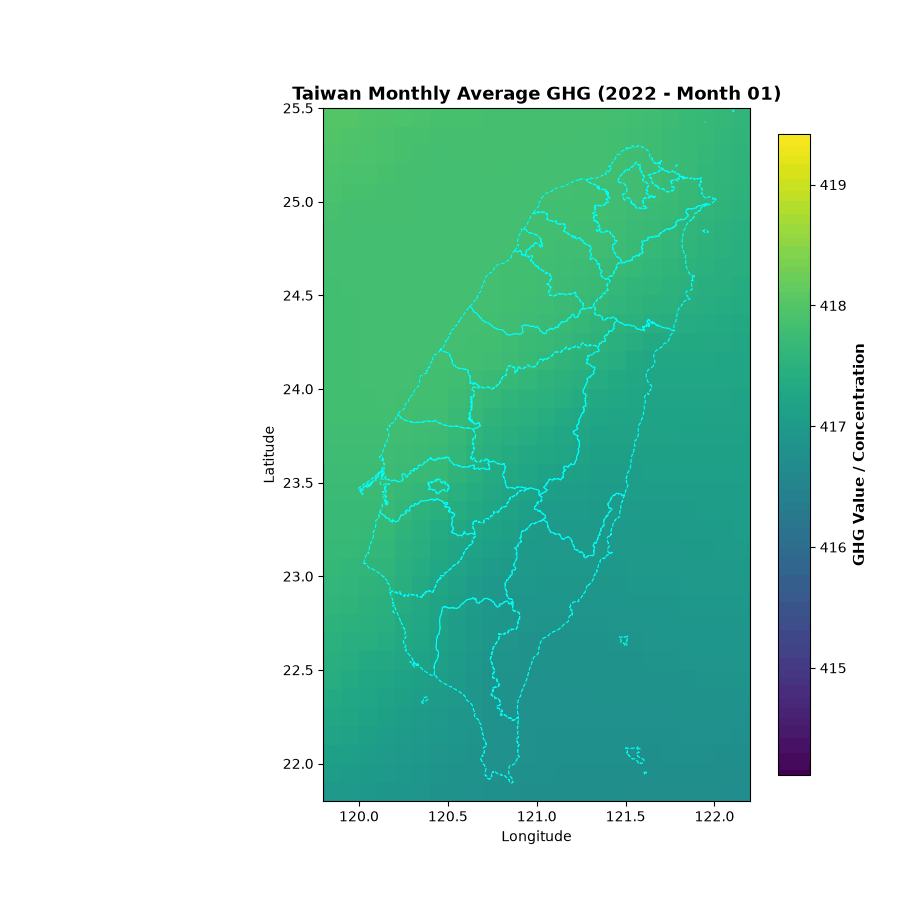
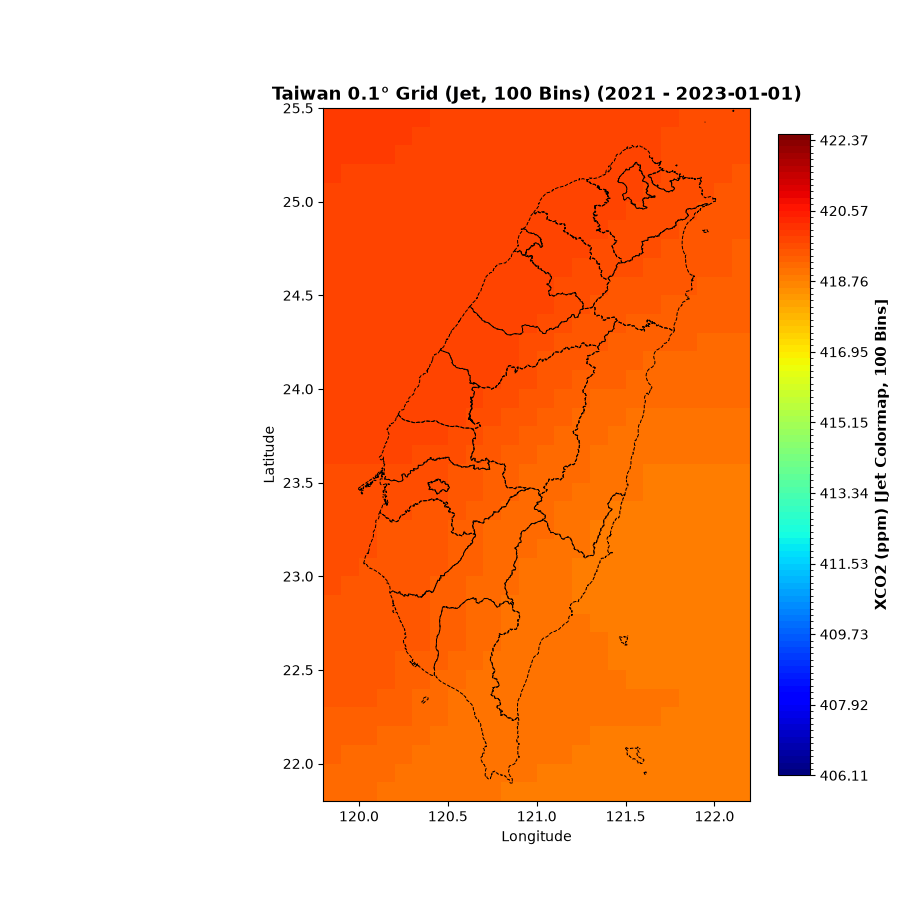
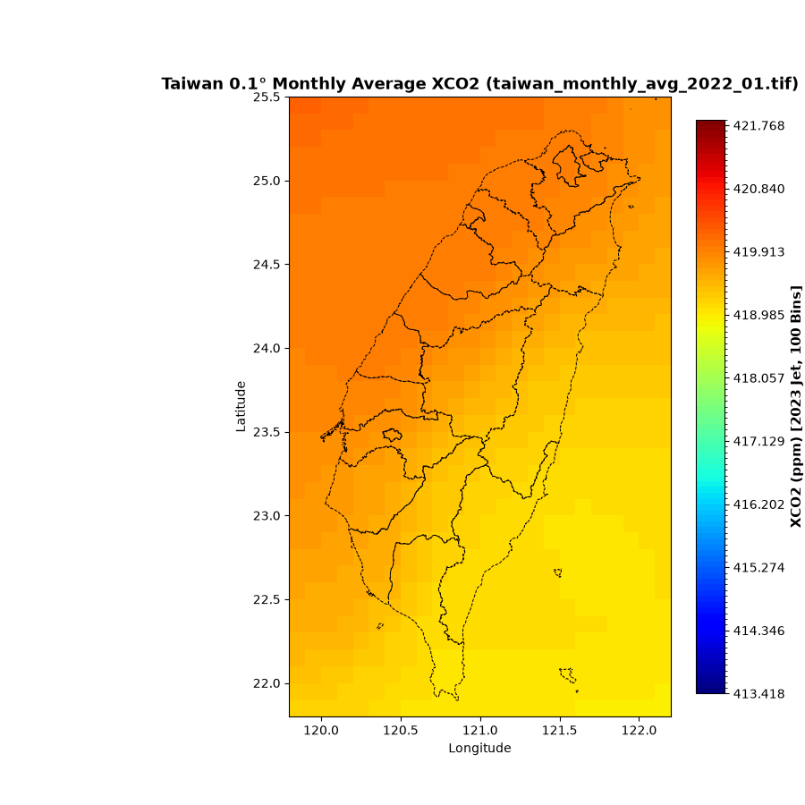

# 🇹🇼 台灣地區CO2時序與視覺化 (Taiwan CO2 Time-Series Visualization)

---

## 📊 視覺化

以下展示 2022 年與 2023 年台灣地區的**每日**與**每月平均**環境時序動態動畫（左方/上方為日動畫，右方/下方為月平均動畫）：

### 📅 2022 年台灣地區環境時序動畫
| 每日時序動畫 (`taiwan_daily_2022.gif`) | 月平均時序動畫 (`taiwan_monthly_2022.gif`) |
| :---: | :---: |
|  |  |

### 📅 2023 年台灣地區環境時序動畫
| 每日時序動畫 (`taiwan_daily_2023.gif`) | 月平均時序動畫 (`taiwan_monthly_2023.gif`) |
| :---: | :---: |
|  |  |

---

## 📈 統計數據輸出 (CSV 報表)
針對台中火力發電廠周遭範圍，北緯 24.2°–24.3°N、東經 120.4°–120.5°E）進行像元級數值萃取，並整理成矩陣式報表：
* `taiwan_中火_2022_timeseries.csv`：2022 年每日數值及每月平均統計。
* `taiwan_中火_2023_timeseries.csv`：2023 年每日數值及每月平均統計。

---

## 🛠️ 核心技術與工具
* **Python 核心庫**：`rasterio` (地理圖資解析與裁切)、`geopandas` (縣市行政區邊界疊加)、`matplotlib` (科學視覺化與固定色階正規化)、`pandas` (時序表格與矩陣轉換)。
* **空間座標系統**：WGS84 (`EPSG:4326`) 經緯度格網與台灣縣市行政區 (`COUNTY_MOI_1090820.shp`) 向量圖資對齊。