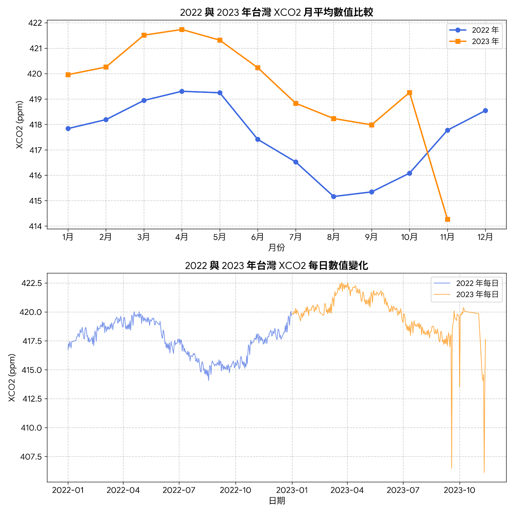

# 🇹🇼 台灣地區 $XCO_2$ 二氧化碳濃度時序分析與網格化視覺化 (Taiwan $XCO_2$ Visualization)

針對台灣地區（經度 $119.8^\circ\text{E} \sim 122.2^\circ\text{E}$，緯度 $21.8^\circ\text{N} \sim 25.5^\circ\text{N}$）之 $XCO_2$（大氣二氧化碳柱平均乾空氣混合比）資料進行空間裁切、$0.1^\circ \times 0.1^\circ$ 重取樣網格化、全域固定色階視覺化，以及重點區域（台中火力發電廠周邊）的時間序列萃取與分析。

---

## 🖼️ 空間視覺化與動態展示

為了確保跨月份與跨年份的色彩對比基準一致，視覺化採用 **100 階離散色階 (100 Bins)**，並透過自動掃描全域 TIF 檔鎖定 Colorbar 上下限，疊加台灣縣市行政區邊界（WGS84 / EPSG:4326）。

### 📅 2022 年台灣地區時序動畫
| 每日 $XCO_2$ (`taiwan_daily_2022.gif`) | 月平均 $XCO_2$ (`taiwan_monthly_2022.gif`) |
| :---: | :---: |
|  |  |

### 📅 2023 年台灣地區時序動畫
| 每日 $XCO_2$ (`taiwan_daily_2023.gif`) | 月平均 $XCO_2$ (`taiwan_monthly_2023.gif`) |
| :---: | :---: |
|  |  |

---

## 📈 2022 vs 2023 年跨年份 $XCO_2$ 趨勢比較

透過萃取之時間序列資料，比較 2022 與 2023 年台灣地區 $XCO_2$ 的月平均與每日數值變化：

---

## 📊 數據報表說明 (CSV Time-Series)

針對台中火力發電廠周遭範圍（北緯 $24.2^\circ \sim 24.3^\circ\text{N}$、東經 $120.4^\circ \sim 120.5^\circ\text{E}$）進行像元級數值萃取，並整理成矩陣式時序報表：

* `taiwan_中火_2022_timeseries.csv`：2022 年每日 $XCO_2$ 數值及每月平均統計。
* `taiwan_中火_2023_timeseries.csv`：2023 年每日 $XCO_2$ 數值及每月平均統計。
