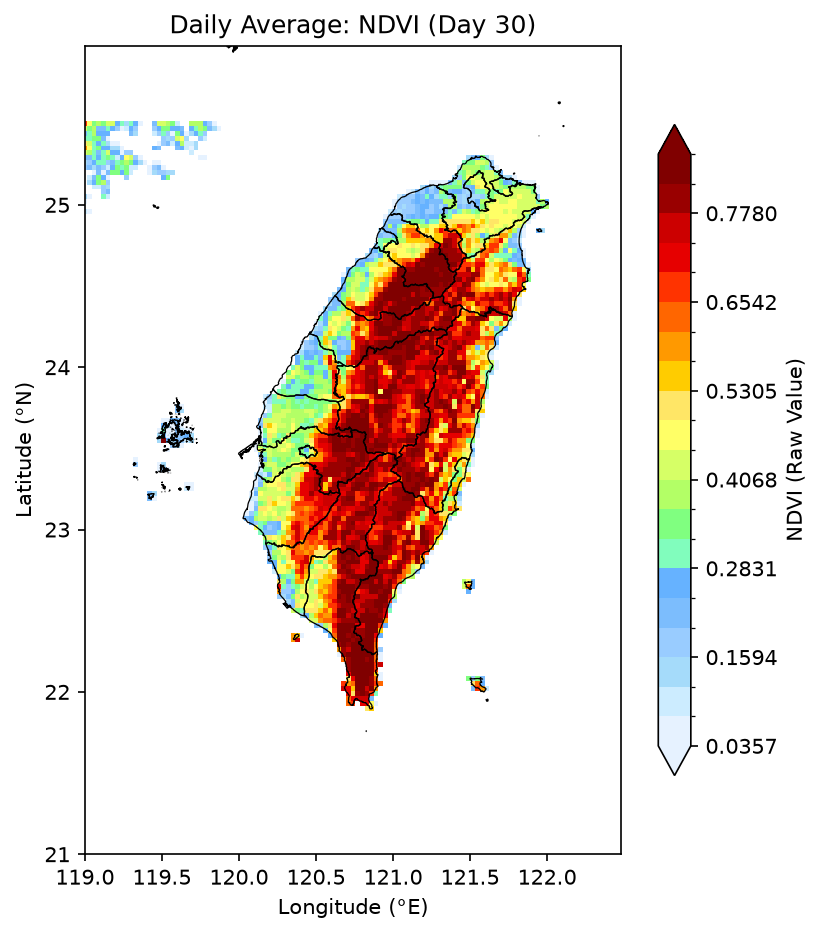

# NDVI 數據集 (NDVI Dataset)

本資料夾包含 NDVI 變數的每日空間分佈圖片檔案。

## 🖼️ 每日圖檔列表 (4 個一列)

<table style="width: 100%; border-collapse: separate; border-spacing: 12px; border: none;">
  <tr>
    <td style="width: 25%; border: none; vertical-align: top; padding: 0;">
      

        
        <a href="day_01.png">day_01.png</a>
      

    </td>
    <td style="width: 25%; border: none; vertical-align: top; padding: 0;">
      

        
        <a href="day_02.png">day_02.png</a>
      

    </td>
    <td style="width: 25%; border: none; vertical-align: top; padding: 0;">
      

        
        <a href="day_03.png">day_03.png</a>
      

    </td>
    <td style="width: 25%; border: none; vertical-align: top; padding: 0;">
      

        
        <a href="day_04.png">day_04.png</a>
      

    </td>
  </tr>
  <tr>
    <td style="width: 25%; border: none; vertical-align: top; padding: 0;">
      

        
        <a href="day_05.png">day_05.png</a>
      

    </td>
    <td style="width: 25%; border: none; vertical-align: top; padding: 0;">
      

        
        <a href="day_06.png">day_06.png</a>
      

    </td>
    <td style="width: 25%; border: none; vertical-align: top; padding: 0;">
      

        
        <a href="day_07.png">day_07.png</a>
      

    </td>
    <td style="width: 25%; border: none; vertical-align: top; padding: 0;">
      

        
        <a href="day_08.png">day_08.png</a>
      

    </td>
  </tr>
  <tr>
    <td style="width: 25%; border: none; vertical-align: top; padding: 0;">
      

        
        <a href="day_09.png">day_09.png</a>
      

    </td>
    <td style="width: 25%; border: none; vertical-align: top; padding: 0;">
      

        
        <a href="day_10.png">day_10.png</a>
      

    </td>
    <td style="width: 25%; border: none; vertical-align: top; padding: 0;">
      

        
        <a href="day_11.png">day_11.png</a>
      

    </td>
    <td style="width: 25%; border: none; vertical-align: top; padding: 0;">
      

        
        <a href="day_12.png">day_12.png</a>
      

    </td>
  </tr>
  <tr>
    <td style="width: 25%; border: none; vertical-align: top; padding: 0;">
      

        
        <a href="day_13.png">day_13.png</a>
      

    </td>
    <td style="width: 25%; border: none; vertical-align: top; padding: 0;">
      

        
        <a href="day_14.png">day_14.png</a>
      

    </td>
    <td style="width: 25%; border: none; vertical-align: top; padding: 0;">
      

        
        <a href="day_15.png">day_15.png</a>
      

    </td>
    <td style="width: 25%; border: none; vertical-align: top; padding: 0;">
      

        
        <a href="day_16.png">day_16.png</a>
      

    </td>
  </tr>
  <tr>
    <td style="width: 25%; border: none; vertical-align: top; padding: 0;">
      

        
        <a href="day_17.png">day_17.png</a>
      

    </td>
    <td style="width: 25%; border: none; vertical-align: top; padding: 0;">
      

        
        <a href="day_18.png">day_18.png</a>
      

    </td>
    <td style="width: 25%; border: none; vertical-align: top; padding: 0;">
      

        
        <a href="day_19.png">day_19.png</a>
      

    </td>
    <td style="width: 25%; border: none; vertical-align: top; padding: 0;">
      

        
        <a href="day_20.png">day_20.png</a>
      

    </td>
  </tr>
  <tr>
    <td style="width: 25%; border: none; vertical-align: top; padding: 0;">
      

        
        <a href="day_21.png">day_21.png</a>
      

    </td>
    <td style="width: 25%; border: none; vertical-align: top; padding: 0;">
      

        
        <a href="day_22.png">day_22.png</a>
      

    </td>
    <td style="width: 25%; border: none; vertical-align: top; padding: 0;">
      

        
        <a href="day_23.png">day_23.png</a>
      

    </td>
    <td style="width: 25%; border: none; vertical-align: top; padding: 0;">
      

        
        <a href="day_24.png">day_24.png</a>
      

    </td>
  </tr>
  <tr>
    <td style="width: 25%; border: none; vertical-align: top; padding: 0;">
      

        
        <a href="day_25.png">day_25.png</a>
      

    </td>
    <td style="width: 25%; border: none; vertical-align: top; padding: 0;">
      

        
        <a href="day_26.png">day_26.png</a>
      

    </td>
    <td style="width: 25%; border: none; vertical-align: top; padding: 0;">
      

        
        <a href="day_27.png">day_27.png</a>
      

    </td>
    <td style="width: 25%; border: none; vertical-align: top; padding: 0;">
      

        
        <a href="day_28.png">day_28.png</a>
      

    </td>
  </tr>
  <tr>
    <td style="width: 25%; border: none; vertical-align: top; padding: 0;">
      

        
        <a href="day_29.png">day_29.png</a>
      

    </td>
    <td style="width: 25%; border: none; vertical-align: top; padding: 0;">
      

        
        <a href="day_30.png">day_30.png</a>
      

    </td>
    <td style="width: 25%; border: none; vertical-align: top; padding: 0;">
      

        
        <a href="day_31.png">day_31.png</a>
      

    </td>
    <td style="width: 25%; border: none; vertical-align: top; padding: 0;"></td>
  </tr>
</table>