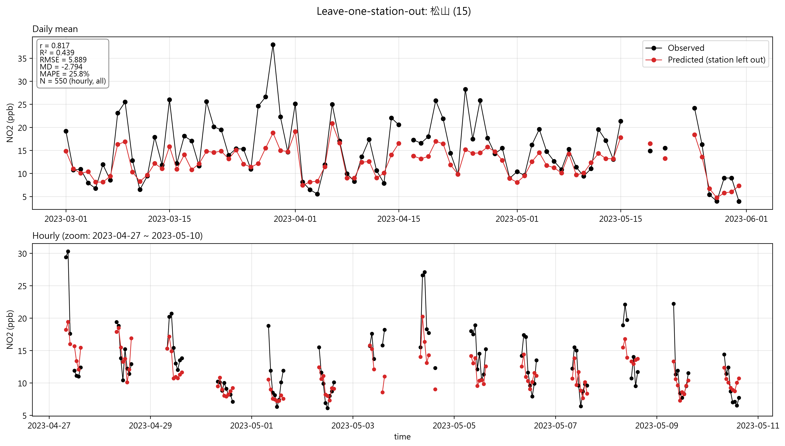
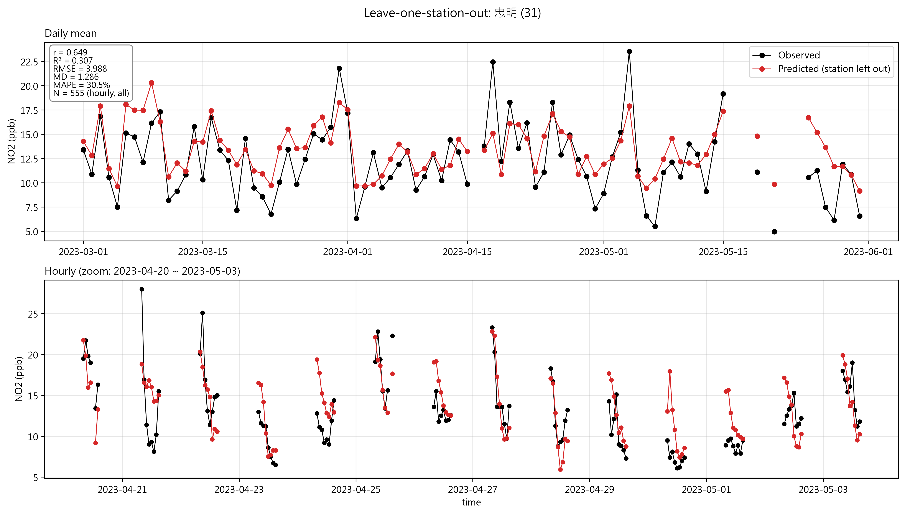
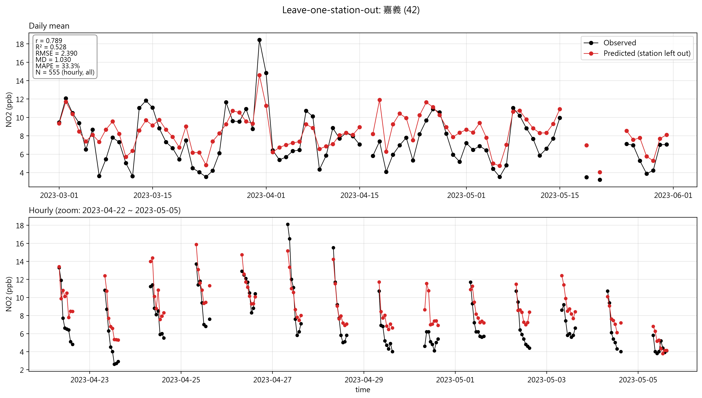
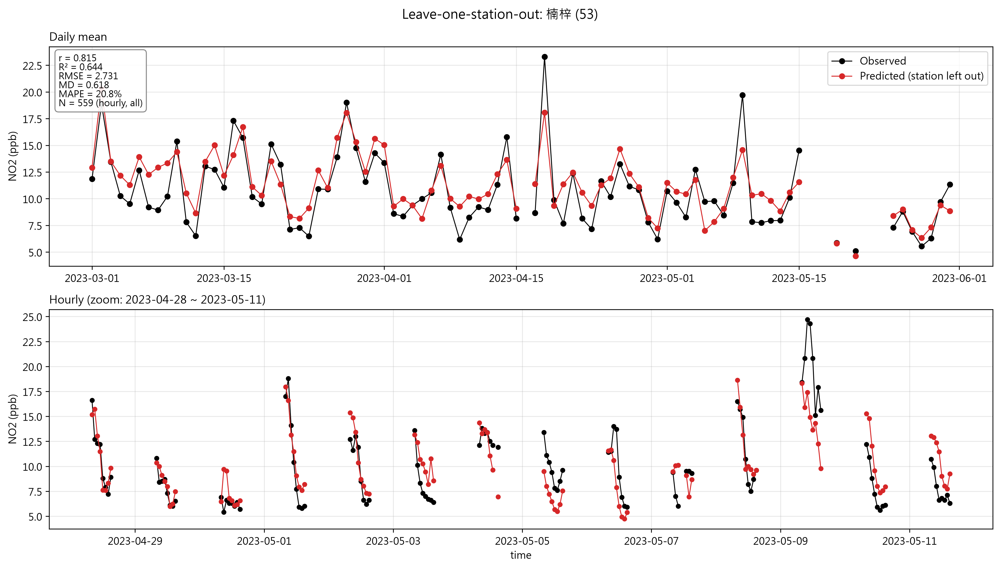

# 留一測站交叉驗證 (LOSO) 實驗報告 - 春季 (Spring)

本實驗針對 2023 年春季（3、4、5 月）地面 $\text{NO}_2$ 濃度進行留一測站交叉驗證（Leave-One-Station-Out, LOSO Cross-Validation），用以評估模型對於未見過測站的空間泛化與預測能力。

---

## 📌 1. 實驗概觀與配置

* **執行時間 / 紀錄目錄**：`./run_20261109_200940_loso_spring`
* **資料季節 (Group)**：春季 (`spring`，包含 3、4、5 月)
* **驗證方式**：留一測站交叉驗證（LOSO CV）
* **測試測站列表**：於總計 75 個測站中，選取 4 個具地理代表性之指定測站(`15 松山`, `31 忠明`, `42 嘉義`, `53 楠梓`)進行 4 次迭代（Folds）；每次迭代輪流以 1 個指定測站作為測試集，其餘 74 個測站作為訓練集，以評估模型對未見測站的空間泛化能力。
* **特徵數量**：18 個特徵欄位
* **特徵列表**：
  `['Hr', 'U', 'V', 'Temp', 'Hum', 'PBLH', 'SWD', 'troposphere_ozone', 'ozone', 'no2', 'VIIRS', 'NDVI', 'Industry', 'Road total length', 'Business', 'Residential', 'MM', 'day']`

---

## 🧹 2. 資料過濾與前處理報告

在進入模型切分前，僅進行缺值過濾（不做數值範圍、離群值、品質旗標或重複列篩選）：

### 2.1 依序過濾結果
* **春季原始資料**：54,600 列
* **剔除資料**：13,386 列（佔春季總資料量 24.5\% ）
* **最終保留資料**：**41,214 列**

| 過濾順序 / 項目 | 扣除列數 | 剩餘列數 |
| :--- | :---: | :---: |
| 原始資料（載入與季節切分後） | - | 54,600 |
| 目標欄位 `NO2_gnd` 缺值 | -2,137 | 52,463 |
| 特徵欄位 `troposphere_ozone` 缺值 | -10,217 | 42,246 |
| 特徵欄位 `no2` 缺值 | -1,032 | 41,214 |
| **最終保留（進入 LOSO 訓練/測試切分）** | - | **41,214** |

### 2.2 月份過濾明細
* **2023-03**：共 18,600 列，移除 5,495 列（ 29.5\% ），保留 13,105 列
* **2023-04**：共 17,400 列，移除 2,638 列（ 15.2\% ），保留 14,762 列
* **2023-05**：共 18,600 列，移除 5,253 列（ 28.2\% ），保留 13,347 列

---

## 🧪 3. 測站 LOSO 評估數據

針對 4 個驗證測站進行留一測試，其餘測站（約 40,650~40,660 列資料）做為訓練集：

| 測站代號與名稱 | 測試樣本數 ($n$) | 訓練集列數 | $R^2$ | RMSE | MD (Mean Difference) |
| :--- | :---: | :---: | :---: | :---: | :---: |
| **15 松山** | 550 | 40,664 | 0.439 | 5.889 | -2.794 |
| **31 忠明** | 555 | 40,659 | 0.307 | 3.988 | +1.286 |
| **42 嘉義** | 555 | 40,659 | 0.528 | 2.390 | +1.030 |
| **53 楠梓** | 559 | 40,655 | 0.644 | 2.731 | +0.618 |

<table>
  <!-- 新增的總標題列 -->
  <tr>
    <td colspan="2" align="center">
      <h3>📈 留一測站交叉驗證（LOSO）各測站時間序列對比圖 <br>
      Time-series comparison of observed and predicted values </h3>
    </td>
  </tr>
  <!-- 第一列圖片 -->
  <tr>
    <td align="center">
      <br>
      <b>松山站</b>
    </td>
  </tr>
  <tr>
    <td align="center">
      <br>
      <b>忠明站</b>
    </td>
  </tr>
  <!-- 第二列圖片 -->
  <tr>
    <td align="center">
      <br>
      <b>嘉義站</b>
    </td>
  </tr>
  <tr>
    <td align="center">
      <br>
      <b>楠梓站</b>
    </td>
  </tr>
</table>


---

## 📊 4. 總體 LOSO 效能摘要

合併 4 個測站共 **2,219 筆預測樣本**進行整體指標計算：

* **皮爾森相關係數 ($r$)**：`0.762`
* **判定係數 ($R^2$)**：`0.572`
* **均方根誤差 (RMSE)**：`3.985`
* **平均偏差 (MD)**：`0.042`
* **平均絕對百分比誤差 (MAPE)**：`27.6%`
* **各測站中位數**：$R^2 = 0.483$, $\text{RMSE} = 3.360$
* **成功預測率** ($R^2 > 0$ 測站比例)：`4/4` ($100\%$)

---

## 🖼️ 5. 輸出圖表與產出檔案結構

所有結果與視覺化圖表皆已儲存至本執行目錄下：

```text
./run_20261109_200940_loso_spring/
├── data_filtering/                     # 資料過濾詳細報告與統計資訊
├── timeseries/                         # 4 張測站時間序列預測圖
│   ├── station_15_timeseries.png
│   ├── station_31_timeseries.png
│   ├── station_42_timeseries.png
│   └── station_53_timeseries.png
├── ground_truth_vs_model_loso.png      # 真實值 vs. 預測值 散佈圖 (Scatter Plot)
├── loso_station_metrics.png            # 各測站評估指標條形圖 (Metrics Comparison)
├── loso_station_map_R2.png             # 測站空間分佈圖 (以 R² 標註)
└── loso_station_map_RMSE.png           # 測站空間分佈圖 (以 RMSE 標註)
```

### 主要圖表說明：
1. **`ground_truth_vs_model_loso.png`**：顯示整體預測點與 1:1 對角線的貼合程度。
2. **`loso_station_metrics.png`**：比較松山、忠明、嘉義、楠梓四個測站間的 $R^2$、RMSE 與 MD 差異。
3. **`loso_station_map_R2.png` / `loso_station_map_RMSE.png`**：結合地理座標展示測站表現的空間異質性。
4. **`timeseries/`**：展示各測站隨時間變化的真實 $\text{NO}_2$ 濃度與模型預測曲線。