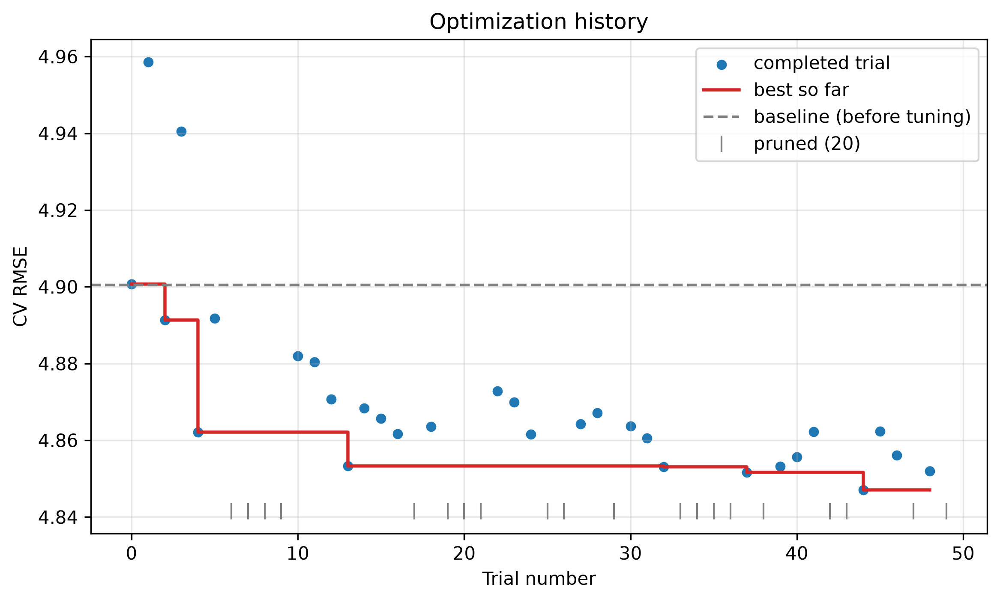
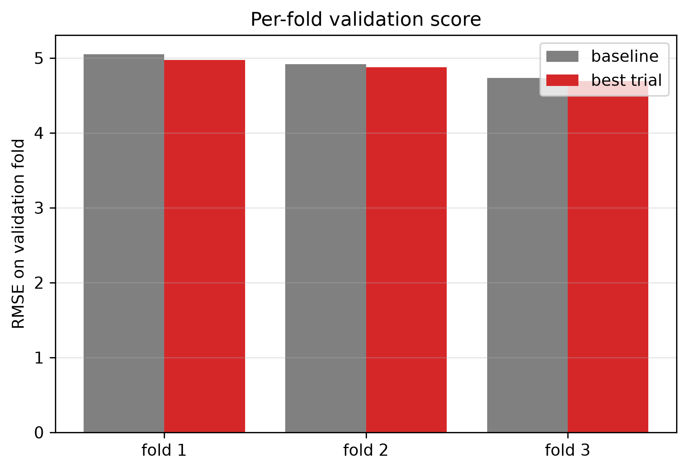
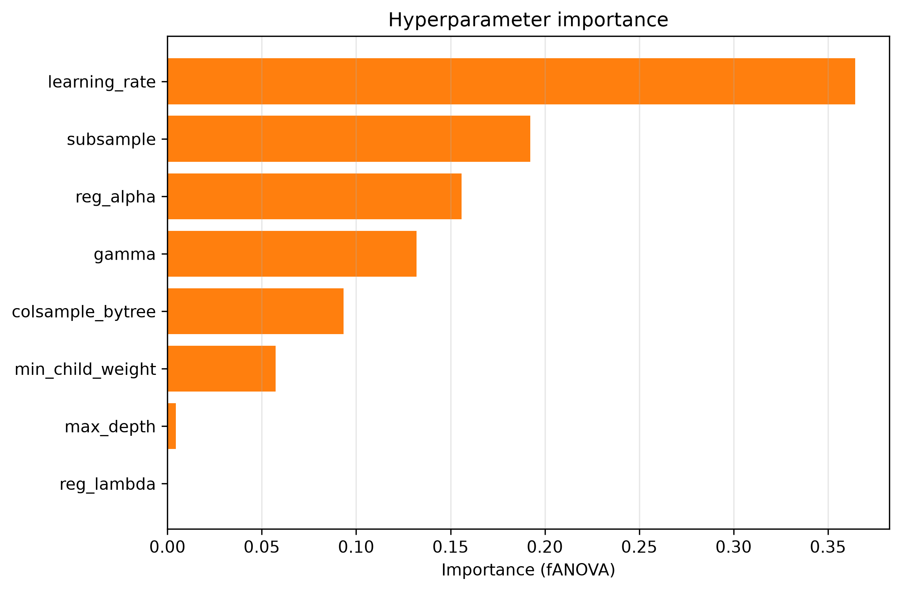
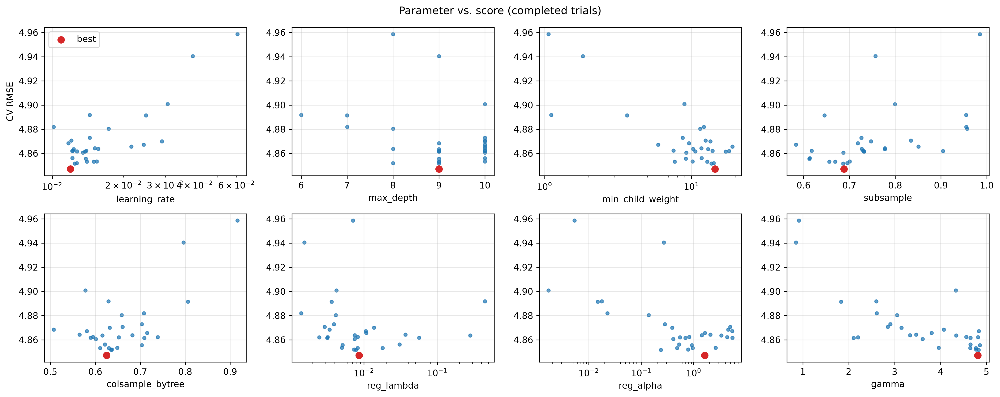

# Optuna 超參數搜尋報告（訓練組別：spring）

## 1. 目的與結論摘要

- 目的：自動搜尋 XGBoost 超參數，降低交叉驗證的 RMSE。
- 資料：32971 筆訓練資料、18 個輸入特徵；**測試集完全不參與搜尋**。
- 結果：最佳 CV RMSE = **4.8471**（第 44 次試驗），調參前基準 = 4.9005，改善 **1.1%**。
- 規模：共 50 次試驗（完成 30、剪枝 20、失敗 0），耗時 1 分 24 秒。
- 最終使用的樹數：290（最佳試驗各摺 early stopping 輪次 [237, 373, 180] 的平均 × 1.1）。

## 2. 搜尋策略

### 2.1 驗證方式：訓練資料內的時間序列交叉驗證

- **為什麼不用測試集調參**：測試集若被拿來挑參數，測試指標就不再代表模型對新資料的表現。因此搜尋只用訓練資料，測試集留到最後才評估。
- **為什麼按時間、以日期切摺**：資料有時間順序，且同一天、不同測站的資料高度相關。採「擴展視窗」切成 3 摺：每摺用較早的資料訓練、之後一段時間驗證，並以整天為單位切分（依日期欄位），避免用未來預測過去，也避免同一天同時出現在訓練與驗證。

| 摺 | 訓練期間 | 訓練筆數 | 驗證期間 | 驗證筆數 |
|---|---|---|---|---|
| 1 | 2023-03-01 ~ 2023-03-18 | 7674 | 2023-03-19 ~ 2023-04-05 | 7939 |
| 2 | 2023-03-01 ~ 2023-04-05 | 15613 | 2023-04-06 ~ 2023-04-23 | 8375 |
| 3 | 2023-03-01 ~ 2023-04-23 | 23988 | 2023-04-24 ~ 2023-05-10 | 8983 |

- 每摺最多訓練 2000 棵樹，並以該摺的驗證集做 early stopping（50 輪沒進步就停），因此樹數不需要列入搜尋。

### 2.2 優化目標與搜尋演算法

- **目標**：各摺驗證集 RMSE 的平均（越小越好）。
- **取樣器：TPE**（Tree-structured Parzen Estimator，multivariate，seed=42）。它根據已完成試驗的結果，把參數分成「表現好」與「表現差」兩群，之後傾向在好的那群較常出現的區域取樣；前 10 次先隨機探索以建立初始資訊，multivariate 模式會考慮參數之間的交互作用。
- **剪枝：中位數剪枝**。每跑完一摺就回報目前的平均分數，若比同一階段其他試驗的中位數更差，這次試驗就提早結束，把時間留給更有希望的組合（前 5 次試驗不剪枝）。注意：第一摺的訓練資料最少，剪枝主要依據前幾摺的表現。
- **基準對照**：搜尋前先用目前 `config.MODEL_PARAMS` 跑一次完全相同的交叉驗證，所有改善都以它為比較對象。
- **試驗上限**：50 次。

### 2.3 搜尋空間

| 參數 | 型別 | 範圍 | 尺度 |
|---|---|---|---|
| learning_rate | float | 0.01 ~ 0.2 | 對數 |
| max_depth | int | 3 ~ 10 | 線性 |
| min_child_weight | float | 1 ~ 20 | 對數 |
| subsample | float | 0.5 ~ 1 | 線性 |
| colsample_bytree | float | 0.5 ~ 1 | 線性 |
| reg_lambda | float | 0.001 ~ 10 | 對數 |
| reg_alpha | float | 0.001 ~ 10 | 對數 |
| gamma | float | 0 ~ 5 | 線性 |

固定不變的參數：`random_state=42`, `n_jobs=-1`。

## 3. 搜尋過程

- 完成 30 次、剪枝 20 次（40%）。
- 單次試驗耗時中位數 1.8 秒；被剪枝的試驗通常較快結束。

最佳分數的進展（只列出刷新紀錄的試驗）：

| 試驗 | CV RMSE | 相對基準改善 |
|---|---|---|
| 0 | 4.9007 | -0.0% |
| 2 | 4.8914 | 0.2% |
| 4 | 4.8621 | 0.8% |
| 13 | 4.8534 | 1.0% |
| 32 | 4.8531 | 1.0% |
| 37 | 4.8517 | 1.0% |
| 44 | 4.8471 | 1.1% |



## 4. 結果

### 4.1 最佳參數

| 參數 | 調參前 | 最佳 |
|---|---|---|
| learning_rate | 0.03 | 0.01196 |
| max_depth | 6 | 9 |
| min_child_weight | 1（XGBoost 預設） | 14.45 |
| subsample | 0.8 | 0.6882 |
| colsample_bytree | 0.8 | 0.6248 |
| reg_lambda | 1（XGBoost 預設） | 0.00858 |
| reg_alpha | 0（XGBoost 預設） | 1.624 |
| gamma | 0（XGBoost 預設） | 4.812 |
| n_estimators（樹數） | 162（各摺 early stopping 平均 × 1.1） | 290（同上） |

### 4.2 交叉驗證分數

|  | 第 1 摺 | 第 2 摺 | 第 3 摺 | 平均 |
|---|---|---|---|---|
| 調參前 | 5.0503 | 4.9171 | 4.7340 | 4.9005 |
| 最佳試驗 | 4.9707 | 4.8768 | 4.6938 | 4.8471 |



### 4.3 參數重要性（fANOVA）

| 參數 | 重要性 |
|---|---|
| learning_rate | 0.364 |
| subsample | 0.192 |
| reg_alpha | 0.156 |
| gamma | 0.132 |
| colsample_bytree | 0.093 |
| min_child_weight | 0.057 |
| max_depth | 0.004 |
| reg_lambda | 0.000 |

重要性越高，代表該參數對 CV 分數的影響越大；影響很小的參數可以固定，下一輪把搜尋力氣集中在重要參數上。



各參數與分數的關係（紅點為最佳試驗）：



### 4.4 前 5 名試驗

| 試驗 | CV RMSE | learning_rate | max_depth | min_child_weight | subsample | colsample_bytree | reg_lambda | reg_alpha | gamma |
|---|---|---|---|---|---|---|---|---|---|
| 44 | 4.8471 | 0.01196 | 9 | 14.45 | 0.6882 | 0.6248 | 0.00858 | 1.624 | 4.812 |
| 37 | 4.8517 | 0.01244 | 9 | 13.67 | 0.6864 | 0.6355 | 0.007772 | 0.2367 | 4.829 |
| 48 | 4.8519 | 0.0127 | 8 | 14.16 | 0.6954 | 0.6367 | 0.007344 | 0.7865 | 4.775 |
| 32 | 4.8531 | 0.01498 | 9 | 7.703 | 0.6563 | 0.6107 | 0.01792 | 0.4814 | 4.645 |
| 39 | 4.8532 | 0.01401 | 9 | 12.81 | 0.6691 | 0.6302 | 0.008208 | 0.9591 | 4.771 |

前幾名的參數越接近，代表搜尋越收斂；差異很大但分數相近，代表有多組參數同樣好。

## 5. 測試集對照（搜尋完成後才評估）

兩個模型都用**整個訓練集**、固定樹數（調參前 162 棵、調參後 290 棵）訓練，不使用測試集做 early stopping，因此兩者的測試指標可以公平比較。

| 指標 | 調參前 | 調參後 |
|---|---|---|
| r | 0.7293 | 0.7320 |
| R2 | 0.5138 | 0.5164 |
| RMSE | 4.9853 | 4.9719 |
| MD | 0.9040 | 0.9402 |
| MAPE | 76.46% | 76.46% |

測試集 RMSE：4.9853 → 4.9719（+0.3% 改善）。

## 6. 判讀與建議

- 改善幅度中等，屬於調參常見的範圍。
- 最佳解出現在第 44 次，已接近試驗上限，搜尋可能還沒收斂，可增加 `OPTUNA_N_TRIALS` 後續跑（設定 `OPTUNA_STORAGE` 可接續）。
- `gamma` 的最佳值 4.812 貼近搜尋上界 5，可考慮把上界再調高

### 注意事項

- 交叉驗證的最佳分數是「從 50 次試驗中挑出最好的一個」，會略微樂觀；真正的泛化表現請看測試集。
- 這組最佳參數是針對**目前的訓練資料、特徵與組別**搜尋的；換組別（春季 / 全年）或改特徵後，建議重新搜尋。
- 比較春季與全年模型時，兩者都應各自搜尋（或都不搜尋），否則比較的是「調過參」與「沒調過參」的差異。

### 如何使用

```bash
python run_no2_xgb.py --mode spring --params latest      # 沿用這組最佳參數訓練
```

最佳參數與所有試驗記錄在同一資料夾的 `best_params.json`、`trials.csv`。
